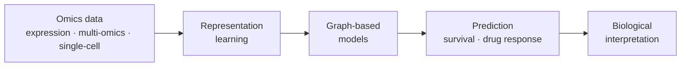

<!-- ===== HEADER BANNER (optional: remove this 
 block if it fails to load) ===== -->

  

<!-- ===== ANIMATED TAGLINE (optional) ===== -->

  

  
  
  

 

## 👋 About Me

I am an MSc student in **Artificial Intelligence** at **Shiraz University** (Faculty of Computer Science), with a **BSc in Electrical Engineering** from **K. N. Toosi University of Technology**. My background brings together engineering, mathematics, programming, and machine learning.

I am interested in applying machine learning to biological data, especially cancer-related problems. This profile shares my technical interests and, over time, my research work.

 

## 🔬 Research Interests

> **Artificial Intelligence and Machine Learning for Computational Biology**

<table>
  <tr>
    <td width="33%" valign="top">
      <h4>🧬 Multi-omics Integration</h4>
      Combining heterogeneous molecular data layers to learn richer biological representations.
    </td>
    <td width="33%" valign="top">
      <h4>🕸️ Graph Neural Networks</h4>
      Learning on biological networks and interaction graphs.
    </td>
    <td width="33%" valign="top">
      <h4>🎗️ Cancer Genomics</h4>
      Survival prediction, risk stratification, and computational cancer biology.
    </td>
  </tr>
  <tr>
    <td width="33%" valign="top">
      <h4>🔎 Single-cell Analysis</h4>
      Computational methods for scRNA-seq and cell-level biology.
    </td>
    <td width="33%" valign="top">
      <h4>📊 ML for Biological Data</h4>
      Representation learning, statistical learning, and gene expression analysis.
    </td>
    <td width="33%" valign="top">
      <h4>💡 Explainable AI</h4>
      Interpretable models for biological and precision-medicine applications.
    </td>
  </tr>
</table>

**Also interested in:** drug response prediction · machine learning for precision medicine · systems biology · biological network analysis

 

### 🧭 Research direction I am interested in

 

## 🛠️ Technical Skills

### ✅ Hands-on experience

  
  
  
  
  
  
  
  
  

| Area | What I have used |
|:--|:--|
| **Programming & scientific computing** | Python for ML and deep learning experiments · NumPy · pandas · R (development environment configured in VS Code on Windows) |
| **Machine learning & deep learning** | PyTorch · scikit-learn |
| **Survival analysis** | lifelines (in Colab) |
| **Graph machine learning** | PyTorch Geometric (tested in a computing environment; early-stage familiarity) |
| **Research tools** | Google Colab · Kaggle Notebooks · VS Code · Git & GitHub |

<b>📐 Foundations I have studied</b>

 

- **Mathematics & statistics:** linear algebra, calculus, probability and statistics, optimization
- **ML concepts:** supervised and unsupervised learning, model evaluation, cross-validation, neural network architectures

### 🌱 Areas I am exploring

  
  
  
  
  
  
  
  
  
  
  
  

Grey badges mark topics and tools I am learning about, not areas of demonstrated expertise.

 

## 🌱 Currently Learning

- Computational biology fundamentals and biological data analysis
- Multi-omics integration approaches
- Graph-based learning for biological networks
- Single-cell analysis workflows

 

## 📁 Selected Projects

*Public projects will be added here as they are ready.*

<!--
Template for future entries (delete this comment when you add your first one):

| Project | Description | Stack |
|:--|:--|:--|
| [Project name](https://github.com/morci1999/REPO_NAME) | One sentence on the problem, data, and method. | Python · PyTorch |
-->

 

## 🎓 Education

| | |
|:--|:--|
| 🎓 **MSc in Artificial Intelligence** | Shiraz University, Faculty of Computer Science |
| 🎓 **BSc in Electrical Engineering** | K. N. Toosi University of Technology |

 

## 📫 Contact

  
  
  

<!-- Replace the placeholder URLs above. Delete any badge you do not use. -->

<!-- ===== FOOTER BANNER (optional) ===== -->

  

